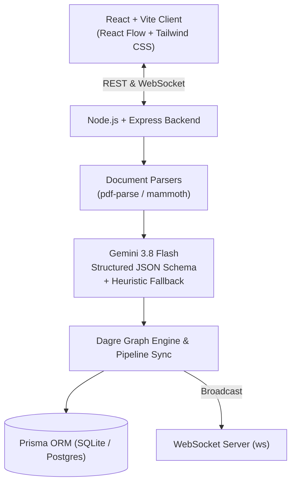

# 🌐 OrgGraph

> **Self-Updating Organizational Knowledge Graph for Project Tracking, powered by Generative AI**

OrgGraph is a full-stack enterprise web application that transforms project reports into a self-updating, interactive organizational knowledge graph. Team progress reports (PDF, DOCX, TXT) are analyzed using **Gemini 3.8 Flash** structured outputs, automatically synthesizing deliverables, progress milestones, health statuses, and active blockers directly into a live hierarchical graph without manual data entry.

---

## ⚡ Key Features

- **Self-Updating Knowledge Graph (React Flow + Dagre)**:
  - **Hierarchical Top-to-Bottom Layout**: `Organization` &rarr; `Department` &rarr; `Team` &rarr; `Project` &rarr; `Stage Pipeline` &rarr; `Blockers`.
  - **Custom Project Nodes**: Circular SVG progress ring (0–100%), color-coded status badge (🟢 On Track, 🟡 At Risk, 🔴 Delayed, 🔵 Completed), and embedded 5-stage pipeline with pulsating glowing indicators on the active stage.
  - **Interactive Side-Panel**: Slide-over panel featuring AI executive summaries, stage progression, active impediments, and full report timeline with original file download.
  - **Canvas Controls**: Search with auto-centering on matching projects, department filter, health status filter, zoom/pan controls, minimap, and collapsible legend.
- **Generative AI Report Extraction Engine**:
  - Powered by `@google/genai` using model `gemini-3.8-flash`.
  - Extracts structured JSON: stage, progress %, health status, executive summary, completed tasks, blockers, risks, people mentioned, and next milestone.
  - **Zero-Downtime Fallback**: Deterministic heuristic regex/semantic extraction engine guarantees 100% demo uptime even without an API key or offline.
- **Multi-Format Document Ingestion**:
  - Drag-and-drop or file upload for `.pdf` (via `pdf-parse`), `.docx` (via `mammoth`), and `.txt`/`.md`, plus a manual structured form mode.
- **Zero-Refresh Real-Time Live Sync**:
  - WebSocket engine (`ws`) broadcasts updates instantly upon report submission. All open manager graph views update live with no page reload.
- **Role-Based Access Control (RBAC)**:
  - **Manager**: Cross-department portfolio overview, assign new projects, organization-wide knowledge graph, global activity notifications.
  - **Employee**: Department-scoped access (Engineering, Marketing, HR, Finance, Operations), team project list, report submission, and personal archive.
- **Modern Dashboard UI**:
  - React 18, Vite, Tailwind CSS, Lucide icons, Dark & Light mode toggle.

---

## 🏗️ Architecture & Tech Stack



| Layer | Technology |
|---|---|
| **Frontend** | React 18, Vite, Tailwind CSS, `@xyflow/react`, `dagre`, `lucide-react` |
| **Backend** | Node.js (ES Modules), Express, `ws` (WebSockets), Multer |
| **Database** | Prisma ORM with SQLite (default) / PostgreSQL support |
| **AI Engine** | `@google/genai` (`gemini-3.8-flash`) + Resilient Heuristic Fallback |
| **Parsers** | `pdf-parse`, `mammoth`, UTF-8 text decoder |

---

## 🚀 Quick Start & Installation

### 1. Prerequisites
- **Node.js** >= 18 (Tested on v24)
- **npm** >= 9

### 2. Clone / Setup Repositories

```bash
# In project root
cd "c:\Users\arneshkannan\Desktop\S5 project"
```

### 3. Server Setup

```bash
cd server
npm install

# Push Prisma schema and seed database
npx prisma generate
npx prisma db push
npm run db:seed

# Start backend server (Port 5000)
npm run dev
```

### 4. Client Setup

```bash
cd ../client
npm install

# Start Vite development server (Port 5173)
npm run dev
```

Open your browser at **`http://localhost:5173`**.

---

## 🔑 Pre-Seeded Demo Credentials

| Role | Name | Department | Email | Password |
|---|---|---|---|---|
| **Manager** | Eleanor Vance | All Departments | `manager@orggraph.internal` | `Manager@123` |
| **Employee** | Alice Chen | Engineering (Frontend Core) | `alice@eng.orggraph.internal` | `Employee@123` |
| **Employee** | Bob Martinez | Engineering (Backend & Cloud) | `bob@eng.orggraph.internal` | `Employee@123` |
| **Employee** | Charlie Kim | Marketing (Growth & Acq.) | `charlie@mkt.orggraph.internal` | `Employee@123` |
| **Employee** | Evan Wright | HR (Talent & Recruiting) | `evan@hr.orggraph.internal` | `Employee@123` |
| **Employee** | George Bailey | Finance (FP&A) | `george@fin.orggraph.internal` | `Employee@123` |
| **Employee** | Ian Malcolm | Operations (Cloud Infra) | `ian@ops.orggraph.internal` | `Employee@123` |

*(The login page includes 1-click preset buttons for instant testing).*

---

## ⚙️ Environment Variables

Copy `.env.example` to `server/.env`:

```env
PORT=5000
DATABASE_URL="file:./dev.db"
JWT_SECRET="orggraph-jwt-super-secret-key-2026-secure"

# Optional: Add your Google Gemini API key
# If left empty, OrgGraph seamlessly uses its deterministic heuristic parser
GEMINI_API_KEY=""
```

---

## 🧪 Testing the Self-Updating Graph Flow

1. **Sign in as Manager** (`manager@orggraph.internal` / `Manager@123`).
2. Observe the initial state of the **Knowledge Graph** (e.g. *NextGen Customer Portal* is in *Development* at 65%).
3. Open a second browser tab or private window, and **Sign in as Employee** (`alice@eng.orggraph.internal` / `Employee@123`).
4. Click **Submit Report** and upload `server/sample_reports/nextgen_portal_testing_report.txt` (or enter text).
5. Watch the Manager screen update **live in real-time**:
   - The stage pipeline advances to **Testing** with an active pulsing amber glow.
   - The circular progress ring increases to **78%**.
   - An instant toast notification pops up announcing the team's submission.
   - Clicking the project card reveals the AI extraction, completed milestones, and original report download link.
